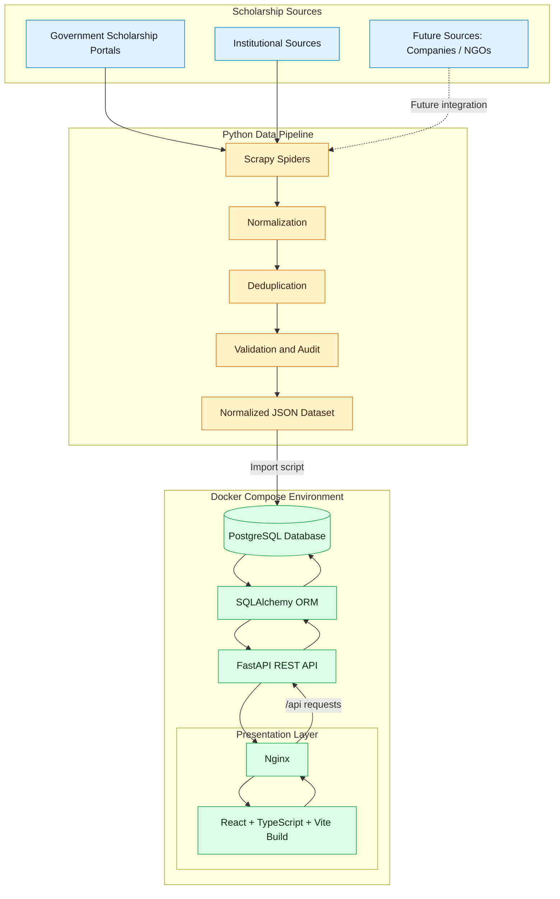
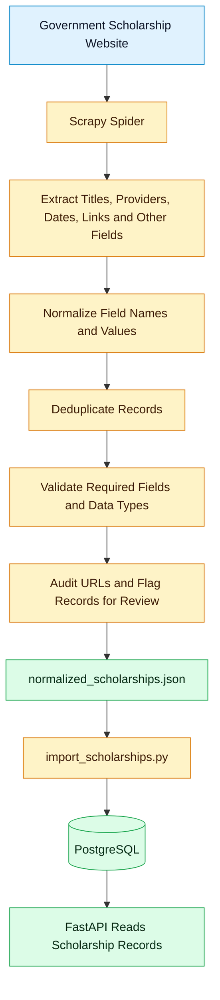
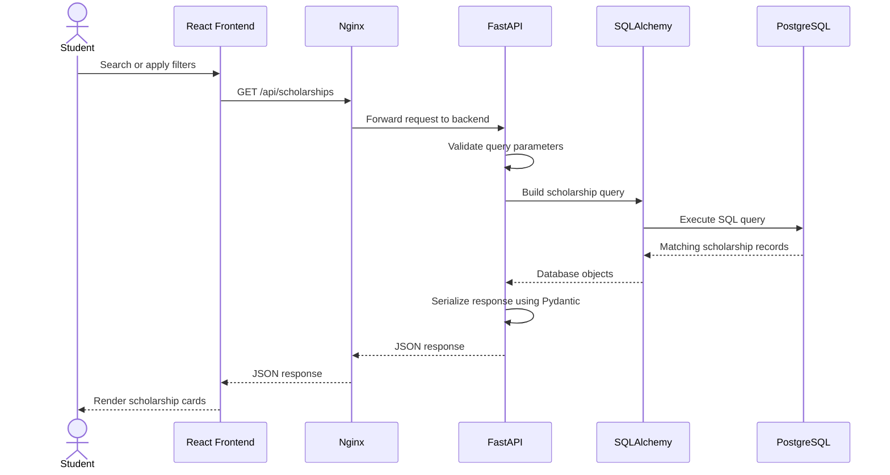
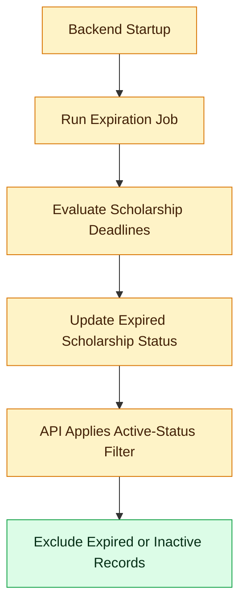
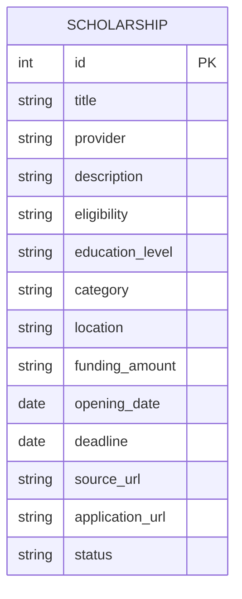

# 🎓 Scholarship Finder

### Your future, funded.

**Discover scholarship opportunities. Explore eligibility details. Find the right path to fund your education.**

Scholarship Finder is a web application designed to collect, organize, and present scholarship opportunities in one searchable directory. It currently focuses on government scholarship sources, with a scraping and data-processing pipeline that prepares scholarship records for storage and display through a web interface.

<p align="center">


</p>

<p align="center">
  <strong>React + TypeScript · FastAPI · PostgreSQL · Scrapy · Docker</strong>
</p>

<p align="center">
  <a href="#-features">Features</a> •
  <a href="#-screenshots">Screenshots</a> •
  <a href="#-architecture">Architecture</a> •
  <a href="#-data-flow">Data Flow</a> •
  <a href="#-getting-started">Getting Started</a>
</p>

---

## 📌 Table of Contents

- [Overview](#-overview)
- [Features](#-features)
- [Screenshots](#-screenshots)
- [Technology Stack](#-technology-stack)
- [System Architecture](#-architecture)
- [Data Flow](#-data-flow)
- [Project Structure](#-project-structure)
- [Scraping and Data Processing](#-scraping-and-data-processing)
- [Backend API](#-backend-api)
- [Database Design](#-database-design)
- [Run with Docker](#-getting-started)
- [Run Locally Without Docker](#-run-locally-without-docker)
- [Environment Variables](#-environment-variables)
- [Data Quality and Scholarship Expiration](#-data-quality-and-scholarship-expiration)
- [Future Improvements](#-future-improvements)
- [Contributing](#-contributing)
- [Disclaimer](#-disclaimer)

---

## 🌟 Overview

Finding financial support for education can be challenging when scholarship information is spread across different government portals and institutional websites. Students may need to search multiple sources, compare eligibility conditions, identify application deadlines, and locate official application links.

Scholarship Finder aims to simplify this process by bringing scholarship information into a structured, searchable directory.

The application combines a web interface, REST API, relational database, and a Python-based data collection pipeline.

### How it helps

- **Discover:** Browse scholarship opportunities in one place.
- **Search:** Find records using scholarship titles and provider names.
- **Filter:** Narrow results by education level, category, location, and deadline.
- **Understand:** Review scholarship descriptions, eligibility information, funding details, and available links.
- **Organize:** Store normalized scholarship records in PostgreSQL.
- **Maintain:** Validate, deduplicate, audit, and expire scholarship records through the data pipeline and backend logic.

> **Project scope:** The current implementation focuses on government scholarship data. Additional company and NGO sources can be integrated as the scraper pipeline expands.

---

## ✨ Features

### 🔎 Scholarship Discovery

- Search scholarship titles and providers.
- Browse scholarship cards in a responsive interface.
- Open individual scholarship detail pages.
- Review provider, education level, location, deadline, and funding information where available.
- Follow source and detailed-information links when those links exist in the underlying record.

### 🎯 Search and Filtering

The backend supports:

- Education-level filtering
- Scholarship-category filtering
- Location filtering
- Deadline-before and deadline-after filters
- Text search across titles, providers, eligibility, and categories
- Paginated scholarship listing

### 🧹 Data Processing Pipeline

The scraping and processing scripts support a structured workflow for collecting and preparing scholarship data.

- Scrape scholarship listings using Scrapy.
- Normalize records into a consistent schema.
- Deduplicate records.
- Validate the resulting data.
- Audit URLs and required fields.
- Produce records for import into the database.

### 🗄️ Database and API

- PostgreSQL for persistent scholarship storage.
- SQLAlchemy for database access.
- Pydantic schemas for API response validation.
- FastAPI for REST endpoints.
- Scholarship expiration logic during backend startup.

### 🐳 Containerized Application

- Docker images for the frontend and backend.
- PostgreSQL running in a separate container.
- Docker Compose for orchestrating the services.
- Persistent PostgreSQL storage through a named Docker volume.
- Nginx serving the production frontend and forwarding API requests.

---

## 🖼️ Screenshots

The screenshots below illustrate the current user interface. Replace each placeholder URL with the corresponding GitHub-hosted image URL.

### 1. Homepage

<!-- ADD SCREENSHOT 1 URL: HOMEPAGE / HERO SECTION -->
<p align="center">
  

</p>

The homepage introduces Scholarship Finder, provides a prominent scholarship search field, and directs users to browse available opportunities.

### 2. Scholarship Discovery

<!-- ADD SCREENSHOT 2 URL: SCHOLARSHIP CARDS / DISCOVERY SECTION -->
<p align="center">
  

</p>

The discovery section presents scholarship cards with information such as provider, scholarship title, education level, deadline, and funding amount when available.

### 3. Browse and Filter Scholarships

<!-- ADD SCREENSHOT 3 URL: SEARCH, FILTERS AND RESULTS PAGE -->
<p align="center">
  

</p>

The directory allows users to search records and narrow results using available filters.

### 4. Scholarship Details

<!-- ADD SCREENSHOT 4 URL: INDIVIDUAL SCHOLARSHIP DETAILS PAGE -->
<p align="center">
  

</p>

The detail page presents the selected scholarship's description, eligibility information, and available source or application links.

---

## 🧰 Technology Stack

| Layer | Technology | Purpose |
|---|---|---|
| Frontend | React | Component-based user interface |
| Frontend language | TypeScript | Typed frontend development |
| Frontend tooling | Vite | Development server and production builds |
| Styling | CSS | Application styling and responsive layouts |
| Backend | Python, FastAPI | REST API and request handling |
| Data validation | Pydantic | Validation and serialization of API data |
| ORM | SQLAlchemy | Database queries and object-relational mapping |
| Database | PostgreSQL 16 | Persistent scholarship storage |
| Database migrations | Alembic | Database schema migration tooling |
| Web scraping | Scrapy | Collecting scholarship information |
| Data processing | Python, JSON, CSV | Normalization, validation, deduplication, and auditing |
| Frontend web server | Nginx | Serving production frontend assets and proxying API requests |
| Containerization | Docker | Packaging application services |
| Orchestration | Docker Compose | Running frontend, backend, and database together |
| Version control | Git and GitHub | Source-code management |

---

## 🏗️ Architecture

Scholarship Finder separates the user interface, API, database, and data ingestion pipeline into distinct responsibilities.

### High-level system architecture



### Architecture components

**1. Data acquisition**

Scrapy spiders collect scholarship listing information from configured sources. The pipeline is designed so that new sources can be added without mixing scraping logic into the frontend or API.

**2. Data processing**

Python scripts normalize fields, identify duplicate records, validate data, and audit required information and URLs. The normalized dataset acts as an input to the database import process.

**3. Persistence**

PostgreSQL stores scholarship records. SQLAlchemy provides the backend's database access layer.

**4. API layer**

FastAPI exposes endpoints for listing, searching, filtering, and retrieving scholarship details. Pydantic response schemas define the expected structure of returned records.

**5. Presentation layer**

React renders the homepage, scholarship directory, filters, cards, and detail pages. Nginx serves the production build and forwards API requests to the backend.

**6. Container orchestration**

Docker Compose runs the database, backend, and frontend as separate services connected over a Docker network.

---

## 🔄 Data Flow

### A. Scholarship ingestion data flow

This flow describes how raw scholarship information becomes structured data available to the application.



**Important:** URL auditing can identify unavailable, blocked, or malformed links, but an HTTP response alone cannot prove that a scholarship is currently accepting applications. Manual verification may still be necessary.

### B. Runtime request and response flow



### C. Scholarship expiration flow



The current backend calls the expiration job during application startup. Active listing and search queries also exclude records whose status is not `ACTIVE` and records with deadlines earlier than the current date. Records without a deadline are not automatically excluded solely because their deadline is missing.

---

## 📁 Project Structure

The following tree summarizes the main files and directories identified in the project materials. Confirm the paths against the current repository if files have been moved or renamed.

```text
Scholarship-Finder/
│
├── backend/
│   ├── app/
│   │   ├── main.py
│   │   ├── database.py
│   │   ├── models.py
│   │   ├── schemas.py
│   │   └── expiration_job.py
│   │
│   ├── migrations/
│   ├── Dockerfile
│   ├── requirements.txt
│   ├── alembic.ini
│   └── import_scholarships.py
│
├── scholarship-finder-frontend/
│   ├── src/
│   │   ├── components/
│   │   ├── pages/
│   │   ├── services/
│   │   └── ...
│   ├── public/
│   ├── Dockerfile
│   ├── package.json
│   └── ...
│
├── scraper/
│   └── scholarship_scraper/
│       ├── spiders/
│       │   ├── nsp_spider.py
│       │   └── ugc_spider.py
│       ├── data/
│       │   ├── normalized_scholarships.json
│       │   ├── deduplicated_scholarships.json
│       │   ├── scholarship_audit.csv
│       │   └── manual_verification.csv
│       ├── normalizer.py
│       ├── deduplicate.py
│       ├── validate_data.py
│       └── audit_scholarships.py
│
├── docker-compose.yml
├── .dockerignore
├── .gitignore
├── scrapy.cfg
└── README.md
```

> The tree is a logical overview, not a guaranteed exact listing of every file. Keep the names and paths aligned with the final repository. In particular, the actual frontend component and page names should be filled in from the current `src` directory.

### Important files

| File | Responsibility |
|---|---|
| `backend/app/main.py` | FastAPI initialization, scholarship endpoints, filtering, and startup expiration logic |
| `backend/app/database.py` | Database engine, session management, and declarative base |
| `backend/app/models.py` | SQLAlchemy database models |
| `backend/app/schemas.py` | Pydantic API schemas |
| `backend/app/expiration_job.py` | Scholarship expiration handling |
| `backend/import_scholarships.py` | Imports normalized scholarship data into PostgreSQL |
| `scraper/.../nsp_spider.py` | Scrapes scholarship listing information from the National Scholarship Portal |
| `scraper/.../ugc_spider.py` | UGC scholarship source spider |
| `scraper/.../normalizer.py` | Standardizes scraped scholarship records |
| `scraper/.../deduplicate.py` | Removes duplicate records |
| `scraper/.../validate_data.py` | Validates processed scholarship data |
| `scraper/.../audit_scholarships.py` | Audits records and URLs |
| `docker-compose.yml` | Defines the database, backend, frontend, ports, and persistent volume |

---

## 🕷️ Scraping and Data Processing

The data pipeline is intentionally separated from the live API. This allows the dataset to be collected and reviewed before records are imported into the database.

### Processing stages

| Stage | Purpose |
|---|---|
| Scraping | Extract scholarship information from configured source websites |
| Normalization | Convert inconsistent source fields into a common record structure |
| Deduplication | Identify repeated scholarship records |
| Validation | Check record shape, required fields, and data quality |
| URL auditing | Test URL formatting and attempt live URL checks |
| Manual verification | Provide a review dataset for details that need human confirmation |
| Import | Load the normalized JSON dataset into PostgreSQL |
| Serving | Expose stored records through the REST API |

### Typical scholarship fields

A normalized scholarship record may contain fields such as:

- Scholarship title
- Provider or administering organization
- Description
- Eligibility information
- Education level
- Scholarship category
- Location
- Funding amount
- Opening date
- Deadline
- Source URL
- Application URL
- Detail or guidelines URLs
- Status

The precise fields depend on the source record and the application's current database schema. Missing values should be represented honestly rather than guessed.

### Running the data pipeline

Run commands from the directory containing the corresponding script, or adjust the paths to match the actual repository.

```bash
# Example: run the relevant Scrapy spider
scrapy crawl nsp

# Process the collected data
python normalizer.py
python deduplicate.py
python validate_data.py
python audit_scholarships.py
```

The order above represents the intended processing sequence. Confirm the actual Scrapy output location and spider output configuration before running it, since these determine whether the subsequent scripts receive the expected input.

To import the normalized dataset into the Docker database, use the backend container:

```bash
docker compose exec backend python import_scholarships.py
```

This command assumes the normalized JSON file has been copied to the path expected by the import script in the backend image.

---

## 🔌 Backend API

The FastAPI application exposes the following endpoints.

| Method | Endpoint | Description |
|---|---|---|
| `GET` | `/` | API welcome and status response |
| `GET` | `/health` | Health check including a database connection test |
| `GET` | `/scholarships` | List active scholarships with pagination and filters |
| `GET` | `/scholarships/search?q=...` | Search active scholarships by text |
| `GET` | `/scholarships/{scholarship_id}` | Retrieve one active scholarship by ID |

### Example requests

List scholarships:

```http
GET /scholarships?limit=20&offset=0
```

Filter by education level:

```http
GET /scholarships?education_level=undergraduate
```

Filter by category and location:

```http
GET /scholarships?category=merit&location=India
```

Filter by deadline:

```http
GET /scholarships?deadline_after=2026-01-01&deadline_before=2026-12-31
```

Search by scholarship title or provider:

```http
GET /scholarships/search?q=Pragati
```

Retrieve a specific scholarship:

```http
GET /scholarships/1
```

The exact results depend on the records stored in the database and their active status.

### Interactive API documentation

When the backend is running locally, FastAPI's interactive documentation is available at:

- Docker backend: `http://localhost:8001/docs`
- Local development backend: `http://localhost:8000/docs` (if running on that port)

The Docker host port can differ from the port used inside the container.

---

## 🗃️ Database Design

PostgreSQL is used to store scholarship records persistently.

The backend uses SQLAlchemy models to map Python objects to database tables and Pydantic schemas to define the response structure returned to clients.

At a conceptual level:



This diagram is conceptual. The exact column names and data types must match `backend/app/models.py`; fields shown here should not be treated as a literal migration specification.

### Database persistence

Docker Compose defines a named volume for PostgreSQL data. This allows database data to survive ordinary container recreation.

Avoid using `docker compose down -v` when you want to preserve the local database, because that command removes the Compose-managed named volumes.

---

## 🚀 Getting Started

### Prerequisites

Install the following tools:

- Git
- Docker Desktop with Docker Compose
- A terminal such as PowerShell, Bash, or the VS Code terminal

You do not need to install PostgreSQL separately when using the provided Docker Compose database service.

### 1. Clone the repository

```bash
git clone https://github.com/Kushagrahms/Scholarship-Finder.git
cd Scholarship-Finder
```

### 2. Configure the environment

Create a root `.env` file for Docker Compose.

Example:

```dotenv
POSTGRES_PASSWORD=replace_with_a_strong_local_password
```

Use a strong password of your own. Do not commit the actual `.env` file.

The backend's local-development configuration may use a separate environment file and database URL. Follow the backend's actual configuration when running outside Docker.

### 3. Build and start the application

From the repository root, run:

```bash
docker compose up --build -d
```

Docker Compose starts the configured services:

- PostgreSQL database
- FastAPI backend
- Nginx frontend

Check their status:

```bash
docker compose ps
```

View backend logs:

```bash
docker compose logs --tail=100 backend
```

View frontend logs:

```bash
docker compose logs --tail=100 frontend
```

### 4. Import scholarship data

If the database is empty, import the normalized scholarship dataset:

```bash
docker compose exec backend python import_scholarships.py
```

The dataset must exist at the path expected by the import script in the backend container.

### 5. Open the application

| Service | Local URL |
|---|---|
| Frontend | `http://localhost:8080` |
| Backend API | `http://localhost:8001` |
| API documentation | `http://localhost:8001/docs` |
| Health check | `http://localhost:8001/health` |

These ports reflect the current local Docker configuration. They may be changed in `docker-compose.yml`.

---

## 💻 Run Locally Without Docker

Local development is useful when changing the frontend, backend, or scraper independently.

### Backend

Create and activate a Python virtual environment, then install the backend dependencies:

```bash
cd backend
python -m venv .venv
```

Activate the environment in PowerShell:

```powershell
.\.venv\Scripts\Activate.ps1
```

Install dependencies:

```bash
pip install -r requirements.txt
```

Configure the database connection for your local PostgreSQL instance and start the API:

```bash
uvicorn app.main:app --reload
```

The default Uvicorn port is `8000`, unless you configure a different port.

### Frontend

Open a separate terminal:

```bash
cd scholarship-finder-frontend
npm ci
npm run dev
```

Vite normally serves the development frontend on `http://localhost:5173`.

Make sure the frontend API configuration points to the correct backend address for the chosen development setup. The Docker configuration uses Nginx to proxy `/api` requests; the local Vite development server may require its own proxy configuration or an appropriate API base URL.

---

## 🔐 Environment Variables

Keep credentials and machine-specific configuration out of version control.

| Variable | Purpose |
|---|---|
| `POSTGRES_PASSWORD` | Password used by the Docker PostgreSQL service |
| `DATABASE_URL` | Backend database connection string |
| `VITE_API_BASE_URL` | Optional frontend API base URL; the current frontend fallback is `/api` |

A typical Docker database connection string has this general form:

```text
postgresql+psycopg://USER:PASSWORD@db:5432/DB_NAME
```

Use `db` as the database hostname from another Compose service on the same network. `localhost` inside a container refers to that container itself, not the PostgreSQL container.

Do not publish real credentials, tokens, private connection strings, or production secrets.

---

## 🧪 Data Quality and Scholarship Expiration

Scholarship information changes over time, and a record can become outdated even if it was valid when collected.

The current implementation includes several safeguards:

- Normalization to reduce inconsistent field representations
- Deduplication to reduce repeated records
- Validation and audit scripts
- Manual verification output for review
- Active-status filtering in the backend
- Startup execution of the scholarship expiration job
- Exclusion of expired deadlines from active listing and search results

### Important limitations

- A missing deadline does not necessarily mean a scholarship is open.
- A working source URL does not prove that applications are currently open.
- A scholarship record should link to an official source whenever possible.
- Scraped information may be incomplete or change after collection.
- The expiration job currently runs during backend startup; it is not, by itself, a weekly scheduled scraper or refresh process.

Users should confirm eligibility, deadlines, funding amounts, and application instructions on the official scholarship website before applying.

---

## 🛣️ Future Improvements

Potential next steps for the project include:

- Scheduled weekly scraping and data refreshes
- Automated detection of changes to scholarship records
- Additional company and NGO scholarship sources
- Improved source-specific scraping and extraction
- Better tracking of verified application URLs and deadlines
- Automated tests for API endpoints and the data pipeline
- Search ranking and richer filtering
- Production deployment with managed database hosting
- Monitoring and error reporting for scraper failures
- More comprehensive scholarship provenance and last-verified timestamps

These are possible future improvements, not claims that the features are already implemented.

---

## 🤝 Contributing

Contributions and suggestions are welcome.

1. Fork the repository.
2. Create a feature branch.
3. Make a focused change.
4. Test the affected functionality.
5. Submit a pull request describing the change.

When adding a new scholarship source, keep extraction logic isolated, normalize records to the existing schema, and validate the resulting data before importing it.

---

## ⚠️ Disclaimer

Scholarship Finder is an information-discovery project. It is not an official government portal and is not affiliated with the National Scholarship Portal, UGC, AICTE, or any scholarship provider unless explicitly stated.

Scholarship availability, eligibility requirements, funding details, and deadlines can change. Always verify information on the official source before relying on it or submitting an application.

---

## 👨‍💻 Project

**Scholarship Finder — Your future, funded.**

Repository: [Kushagrahms/Scholarship-Finder](https://github.com/Kushagrahms/Scholarship-Finder)

Built with React, TypeScript, Python, FastAPI, PostgreSQL, Scrapy, and Docker.
